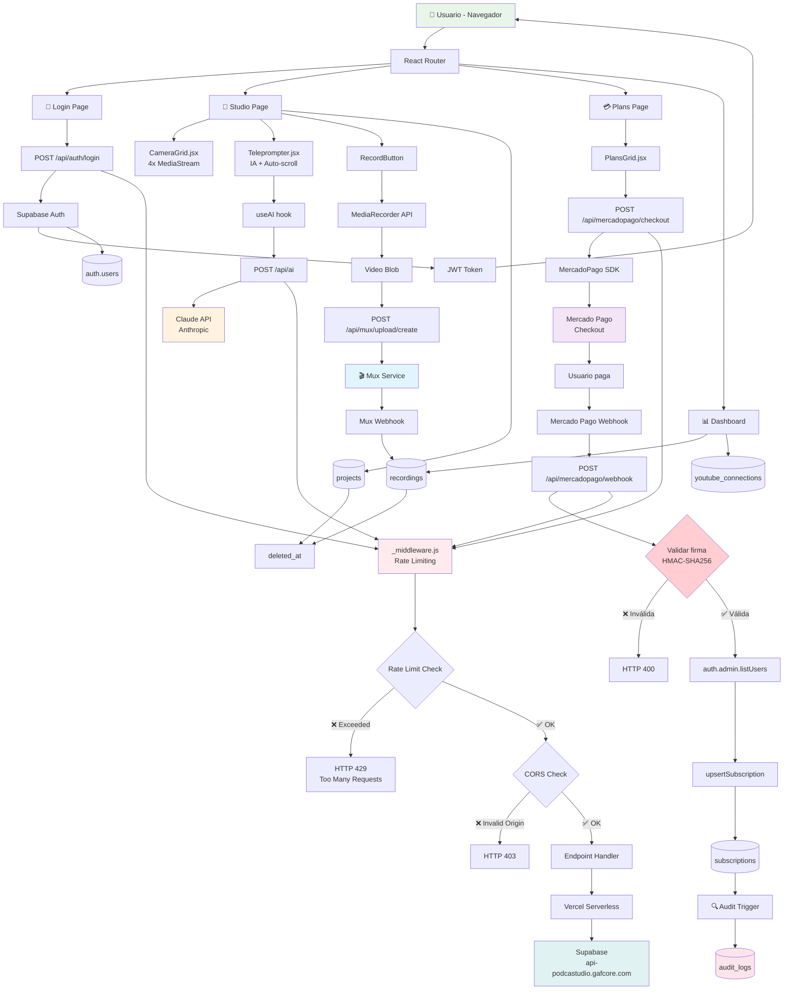

# 🧠 ARCHITECTURE GRAPH - PODCASTUDIO

> **Grafo primario para agentes IA**  
> Leer esto PRIMERO antes de modificar cualquier parte del sistema.  
> Describe cómo está construido, qué va dónde y cómo fluyen los datos.

---

## 🎯 Propósito del Proyecto

**PODCASTUDIO** es un estudio profesional de grabación multicámara en el navegador para podcasters.

**Características principales**:
- ✅ Grabación simultánea de 4 cámaras (MediaStream API)
- ✅ Teleprompter inteligente con IA (Claude API)
- ✅ Procesamiento y hosting de video (Mux)
- ✅ Publicación directa a YouTube (OAuth)
- ✅ Suscripciones con Mercado Pago
- ✅ PWA installable

---

## 📊 GRAFO DE ARQUITECTURA



---

## 🗂️ ESTRUCTURA DE DIRECTORIOS

```
PODCASTUDIO/
│
├── 📄 ARCHITECTURE_GRAPH.md        ← Estás aquí (grafo primario)
├── 📄 ROADMAP/ROADMAP.md           ← Estado del proyecto
├── 📄 API_DOCS.md                  ← Documentación endpoints
├── 📄 FORENSIC_REPORT.md           ← Reporte de análisis
├── 📄 SECURITY_ROTATION.md         ← Rotación de claves
├── 📄 CLAUDE.md                    ← Config infraestructura
│
├── 🌐 Frontend (React 19)
│   ├── src/
│   │   ├── App.jsx                 ← Router + Auth hydration
│   │   ├── main.jsx                ← Entry point
│   │   │
│   │   ├── pages/
│   │   │   ├── Studio.jsx          ← Grabación multicámara
│   │   │   ├── Plans.jsx           ← Checkout Mercado Pago
│   │   │   ├── Dashboard.jsx       ← Gestión grabaciones
│   │   │   └── Login.jsx           ← Autenticación
│   │   │
│   │   ├── components/
│   │   │   ├── CameraGrid.jsx      ← 4 cámaras simultáneas
│   │   │   ├── Teleprompter.jsx    ← IA + scroll
│   │   │   ├── PlansGrid.jsx       ← Planes suscripción
│   │   │   └── RecordButton.jsx    ← Grabación
│   │   │
│   │   ├── hooks/
│   │   │   ├── useAI.js            ← Claude API integration
│   │   │   ├── useCamera.js        ← MediaStream API
│   │   │   └── useRecording.js     ← MediaRecorder
│   │   │
│   │   └── lib/
│   │       ├── supabase.js         ← Client Supabase
│   │       └── billing.js          ← Checkout helpers
│   │
│   ├── public/
│   │   ├── pwa-512x512.png
│   │   └── site.webmanifest
│   │
│   └── vite.config.js              ← Vite 8 + Rolldown
│
├── ⚙️ Backend (Vercel Serverless)
│   ├── api/
│   │   ├── _middleware.js          ← Rate limiting + CORS
│   │   │
│   │   ├── auth/
│   │   │   └── login.js            ← POST /api/auth/login
│   │   │
│   │   ├── mercadopago/
│   │   │   ├── status.js           ← GET /api/mercadopago/status
│   │   │   ├── checkout.js         ← POST /api/mercadopago/checkout
│   │   │   ├── session.js          ← GET /api/mercadopago/session
│   │   │   ├── subscription.js     ← GET /api/mercadopago/subscription
│   │   │   ├── sync.js             ← POST /api/mercadopago/sync
│   │   │   └── webhook.js          ← POST /api/mercadopago/webhook
│   │   │
│   │   ├── ai.js                   ← POST /api/ai
│   │   │
│   │   └── mux/
│   │       └── upload/create.js    ← POST /api/mux/upload/create
│   │
│   └── lib/
│       ├── mercadopago/
│       │   ├── client.js           ← SDK wrapper
│       │   ├── signature.js        ← HMAC-SHA256 validation
│       │   ├── webhooks.js         ← Event handler
│       │   ├── subscriptions.js    ← DB sync
│       │   └── sync.js             ← Manual sync
│       │
│       ├── supabase/
│       │   ├── admin.js            ← Service role client
│       │   └── auth.js             ← Auth helpers
│       │
│       ├── ai/
│       │   ├── claude.cjs          ← Claude API client
│       │   └── config.js           ← API config
│       │
│       └── email/
│           └── resend.js           ← Notificaciones
│
└── 🗄️ Database (Supabase)
    └── supabase/
        ├── config.toml
        └── migrations/
            ├── 20261005000000_init.sql
            ├── 20250114000000_add_indexes.sql
            ├── 20250114000001_audit_logs.sql
            └── 20250114000002_soft_deletes.sql
```

---

## 🔄 FLUJOS DE DATOS CRÍTICOS

### 1️⃣ Flujo de Autenticación

```
Usuario ingresa email + password
  ↓
PlansGrid.jsx → POST /api/auth/login
  ↓ validate credentials
lib/supabase/auth.js → serverSignIn()
  ↓
Supabase Auth API
  ↓ returns
{ access_token, refresh_token, user }
  ↓ store in localStorage
safeStorage.setAccessToken()
  ↓ hydrate user
App.jsx → hydrateUser()
  ↓ redirect
Studio.jsx ✅
```

**Archivos involucrados**:
- `src/pages/Login.jsx`
- `api/auth/login.js`
- `lib/supabase/auth.js`
- `src/App.jsx`

---

### 2️⃣ Flujo de Checkout → Suscripción

```
Usuario en Plans.jsx → Clic en plan "Creator"
  ↓ onClick handler
PlansGrid.jsx → POST /api/mercadopago/checkout
  ↓ body: { planId, email, userId }
api/mercadopago/checkout.js → createPreference()
  ↓ llamada a MP SDK
lib/mercadopago/client.js → MercadoPago.preferences.create()
  ↓ retorna
{ init_point: "https://mercadopago.com/...", id: "pref_xxx" }
  ↓ redirect
window.location.href = init_point
  ↓ usuario paga en MP
Mercado Pago procesa pago
  ↓ callback webhook
POST /api/mercadopago/webhook
  ↓ validar firma
lib/mercadopago/signature.js → verifyMercadoPagoSignature()
  ↓ ✅ firma válida
lib/mercadopago/webhooks.js → handleMPWebhook()
  ↓ buscar usuario
lib/supabase/admin.js → admin.auth.admin.listUsers()
  ↓ find by email
const user = users.find(u => u.email === payerEmail)
  ↓ crear/actualizar suscripción
lib/mercadopago/subscriptions.js → upsertSubscriptionFromMP()
  ↓ INSERT/UPDATE en DB
supabase.from('subscriptions').upsert(...)
  ↓ trigger automático
Audit trigger → INSERT INTO audit_logs
  ↓
Usuario activado ✅
```

**Archivos involucrados**:
- `src/pages/Plans.jsx`
- `src/components/PlansGrid.jsx`
- `api/mercadopago/checkout.js`
- `api/mercadopago/webhook.js`
- `lib/mercadopago/client.js`
- `lib/mercadopago/signature.js` ⭐ NUEVO
- `lib/mercadopago/webhooks.js`
- `lib/mercadopago/subscriptions.js`
- `lib/supabase/admin.js`
- `supabase/migrations/20250114000001_audit_logs.sql`

---

### 3️⃣ Flujo de Grabación → Mux → YouTube

```
Usuario en Studio.jsx → Configura 4 cámaras
  ↓ getUserMedia()
navigator.mediaDevices.getUserMedia({ video, audio })
  ↓ render
CameraGrid.jsx → 4x <video srcObject={stream} />
  ↓ usuario hace clic "Grabar"
RecordButton.jsx → onClick
  ↓ start recording
MediaRecorder API → start()
  ↓ ondataavailable
chunks.push(event.data)
  ↓ onstop
const blob = new Blob(chunks, { type: 'video/webm' })
  ↓ upload
POST /api/mux/upload/create
  ↓ crear upload URL
api/mux/upload/create.js → Mux.video.uploads.create()
  ↓ retorna
{ url: "https://storage.googleapis.com/...", id: "..." }
  ↓ PUT blob to URL
fetch(url, { method: 'PUT', body: blob })
  ↓ Mux procesa
Mux transcode pipeline
  ↓ webhook
POST /api/mux/webhook (cuando asset.ready)
  ↓ actualizar DB
UPDATE recordings SET status='ready', mux_playback_id='...'
  ↓ trigger auditoría
Audit trigger → INSERT INTO audit_logs
  ↓ si YouTube conectado
lib/youtube/publish.js → uploadToYouTube()
  ↓ OAuth
YouTube Data API v3
  ↓ UPDATE
UPDATE recordings SET youtube_video_id='...'
  ↓
Video publicado ✅
```

**Archivos involucrados**:
- `src/pages/Studio.jsx`
- `src/components/CameraGrid.jsx`
- `src/components/RecordButton.jsx`
- `src/hooks/useCamera.js`
- `src/hooks/useRecording.js`
- `api/mux/upload/create.js`
- `lib/mux/client.js`
- `lib/youtube/publish.js`
- `supabase/migrations/20261005000000_init.sql` (tabla recordings)

---

### 4️⃣ Flujo de IA (Teleprompter)

```
Usuario escribe tema en Teleprompter.jsx
  ↓ input onChange
setPrompt("Innovación en podcasting")
  ↓ botón "Generar"
onClick → callAI()
  ↓
useAI hook → fetchWithRetry()
  ↓
POST /api/ai
  ↓ body: { prompt, systemPrompt }
api/ai.js → callClaude()
  ↓
lib/ai/claude.cjs → fetch Anthropic API
  ↓ headers: { x-api-key, anthropic-version }
Claude API (Haiku 4.5)
  ↓ retorna
{ text: "Hoy hablaremos sobre..." }
  ↓ setState
setGeneratedScript(text)
  ↓ auto-scroll
scrolling interval cada 2s
  ↓
Usuario lee script ✅
```

**Archivos involucrados**:
- `src/components/Teleprompter.jsx`
- `src/hooks/useAI.js`
- `api/ai.js`
- `lib/ai/claude.cjs`
- `lib/ai/config.js`

---

## 🔒 CAPA DE SEGURIDAD

### Rate Limiting (api/_middleware.js)

```javascript
// Límites por endpoint
/api/auth/login        → 5 req/min   (prevenir fuerza bruta)
/api/mercadopago/*     → 10 req/min  (prevenir spam checkout)
/api/ai/*              → 20 req/min  (costoso, limitar uso)
Otros endpoints        → 60 req/min  (default)
```

**Implementación**:
- Almacenamiento en memoria (Map)
- Key: `${ip}:${endpoint}`
- Ventana deslizante de 60 segundos
- Headers: `X-RateLimit-Limit`, `X-RateLimit-Remaining`, `X-RateLimit-Reset`

### CORS (vercel.json)

```javascript
// Orígenes permitidos
- https://www.podcastudio.mx  (producción)
- https://podcastudio.mx      (redirect)
- http://localhost:3000       (desarrollo)
```

### CSP (Content-Security-Policy)

```
default-src 'self'
script-src 'self' 'unsafe-inline' 'unsafe-eval' cdn.jsdelivr.net unpkg.com
connect-src 'self' api-podcastudio.gafcore.com api.mercadopago.com
```

### Validación de Webhooks

```javascript
// lib/mercadopago/signature.js
verifyMercadoPagoSignature(rawBody, signature, secret)
  ↓ parse signature header
ts=1234567890,v1=abc123
  ↓ construct payload
`${timestamp}.${rawBody}`
  ↓ calculate HMAC-SHA256
crypto.createHmac('sha256', secret).update(payload).digest('hex')
  ↓ timing-safe comparison
crypto.timingSafeEqual(received, expected)
  ↓ verify timestamp
now - timestamp <= 300 seconds
```

---

## 🗄️ ESQUEMA DE BASE DE DATOS

### Tablas Principales

#### `auth.users` (Supabase Auth)
```sql
- id: uuid PRIMARY KEY
- email: text UNIQUE
- encrypted_password: text
- raw_app_meta_data: jsonb  -- { role: "admin" | "user" }
- created_at: timestamptz
```

#### `public.projects`
```sql
- id: uuid PRIMARY KEY
- user_id: uuid REFERENCES auth.users(id) ON DELETE CASCADE
- data: jsonb  -- { title, description, settings, ... }
- updated_at: timestamptz
- deleted_at: timestamptz  -- ⭐ NUEVO (soft delete)
```

#### `public.subscriptions`
```sql
- user_id: uuid PRIMARY KEY REFERENCES auth.users(id)
- plan_id: text  -- "creator" | "pro" | "business"
- status: text  -- "approved" | "pending" | "rejected"
- mp_preference_id: text
- mp_payment_id: text UNIQUE
- mp_payer_id: text
- current_period_end: timestamptz
- updated_at: timestamptz
- deleted_at: timestamptz  -- ⭐ NUEVO
```

**Índices**:
- `idx_subscriptions_status` ON (status)
- `idx_subscriptions_period_end` ON (current_period_end)

#### `public.recordings`
```sql
- id: uuid PRIMARY KEY
- user_id: uuid REFERENCES auth.users(id)
- title: text
- file_name: text
- duration_sec: int
- mux_upload_id: text
- mux_asset_id: text
- mux_playback_id: text
- youtube_video_id: text
- status: text  -- "uploading" | "processing" | "ready" | "error"
- error_message: text
- created_at: timestamptz
- updated_at: timestamptz
- deleted_at: timestamptz  -- ⭐ NUEVO
```

**Índices**:
- `idx_recordings_user_idx` ON (user_id, created_at DESC)
- `idx_recordings_status` ON (status)
- `idx_recordings_mux_asset_id` ON (mux_asset_id)
- `idx_recordings_youtube_video_id` ON (youtube_video_id)

#### `public.audit_logs` ⭐ NUEVO
```sql
- id: uuid PRIMARY KEY
- user_id: uuid REFERENCES auth.users(id) ON DELETE SET NULL
- action: text  -- "INSERT" | "UPDATE" | "DELETE"
- table_name: text
- record_id: uuid
- old_data: jsonb
- new_data: jsonb
- ip_address: inet
- user_agent: text
- created_at: timestamptz
```

**Índices**:
- `idx_audit_logs_user_id` ON (user_id, created_at DESC)
- `idx_audit_logs_table_action` ON (table_name, action, created_at DESC)

### Triggers Automáticos

```sql
-- Auditoría automática en subscriptions
CREATE TRIGGER audit_subscriptions
  AFTER INSERT OR UPDATE OR DELETE ON subscriptions
  FOR EACH ROW EXECUTE FUNCTION log_audit_event();

-- Similar para projects y recordings
```

### RLS (Row Level Security)

```sql
-- Solo el usuario puede ver sus propios datos
CREATE POLICY "Users read own projects"
  ON projects FOR SELECT
  USING (auth.uid() = user_id AND deleted_at IS NULL);

-- Solo admins leen audit_logs
CREATE POLICY "Admins read audit logs"
  ON audit_logs FOR SELECT
  USING (
    EXISTS (
      SELECT 1 FROM auth.users
      WHERE id = auth.uid()
      AND (raw_app_meta_data->>'role') = 'admin'
    )
  );
```

---

## 🔌 INTEGRACIONES EXTERNAS

### 1. Supabase (Base de datos + Auth)
**URL**: `https://api-podcastudio.gafcore.com`  
**SDK**: `@supabase/supabase-js` v2.108.2  
**Uso**:
- Auth: `supabase.auth.signInWithPassword()`
- DB: `supabase.from('table').select()`
- Real-time: `supabase.channel('changes').on(...)`

### 2. Mercado Pago (Pagos)
**SDK**: `mercadopago` v2.0.18  
**Endpoints usados**:
- `preferences.create()` - Crear checkout
- `payment.get()` - Obtener estado de pago
**Webhook**: `POST /api/mercadopago/webhook`

### 3. Claude API (IA)
**Endpoint**: `https://api.anthropic.com/v1/messages`  
**Modelo**: `claude-haiku-4-5`  
**Headers**:
- `x-api-key: ${MEAI_API_KEY}`
- `anthropic-version: 2023-06-01`

### 4. Mux (Video hosting)
**SDK**: `@mux/mux-node`  
**Uso**:
- Uploads: `Mux.video.uploads.create()`
- Assets: `Mux.video.assets.retrieve()`
- Playback: `https://stream.mux.com/${playback_id}.m3u8`

### 5. YouTube Data API v3
**OAuth**: Google Cloud Console  
**Scopes**: `https://www.googleapis.com/auth/youtube.upload`  
**Uso**: Publicar grabaciones directamente

### 6. Resend (Emails)
**Endpoint**: `https://api.resend.com/emails`  
**Uso**: Notificaciones de bienvenida, grabación lista, etc.

---

## ⚙️ CONFIGURACIÓN Y DESPLIEGUE

### Variables de Entorno (.env.local)

```bash
# Supabase (CRÍTICO)
VITE_SUPABASE_URL=https://api-podcastudio.gafcore.com
VITE_SUPABASE_ANON_KEY=eyJ...
SUPABASE_SERVICE_ROLE_KEY=eyJ...  # NUNCA exponer en cliente

# Mercado Pago (CRÍTICO)
MERCADO_PAGO_ACCESS_TOKEN=APP_USR-...
MERCADO_PAGO_WEBHOOK_SECRET=...  # ⭐ NUEVO - validar firma

# IA
MEAI_API_KEY=...
MEAI_MODEL=claude-haiku-4-5

# Email
RESEND_API_KEY=re_...
RESEND_FROM_EMAIL=PodcastStudio <notificaciones@podcastudio.mx>

# Mux
MUX_TOKEN_ID=...
MUX_TOKEN_SECRET=...

# YouTube OAuth
GOOGLE_CLIENT_ID=...
GOOGLE_CLIENT_SECRET=...

# App
SITE_URL=https://www.podcastudio.mx
VITE_SITE_URL=https://www.podcastudio.mx
```

### Deployment en Vercel

```bash
# Install Vercel CLI
npm i -g vercel

# Deploy a producción
vercel --prod

# Ver logs
vercel logs podcastudio --prod
```

**Configuración automática**:
- Framework: Vite
- Build: `npm run build`
- Output: `dist/`
- Functions: `api/**/*.js`

### CI/CD (Pendiente)

```yaml
# .github/workflows/deploy.yml
name: Deploy
on:
  push:
    branches: [main]
jobs:
  test:
    - npm ci
    - npm run lint
    - npm test  # cuando existan
  deploy:
    - vercel --prod
```

---

## 📈 MÉTRICAS Y MONITORING

### Performance
- **Bundle size**: ~4.8 MB (optimizado, antes 8 MB)
- **LCP (Largest Contentful Paint)**: < 2.5s
- **FID (First Input Delay)**: < 100ms
- **CLS (Cumulative Layout Shift)**: < 0.1

### Database
- **Queries optimizadas**: 6 índices agregados
- **RLS**: Habilitado en todas las tablas
- **Soft deletes**: Recuperación de datos

### Security
- **Rate limiting**: ✅
- **CORS**: ✅
- **CSP**: ✅
- **Webhook validation**: ✅ HMAC-SHA256
- **Audit logs**: ✅ Triggers automáticos

---

## 🚨 PROBLEMAS CONOCIDOS Y SOLUCIONES

### ❌ Problema: Webhook sin validar
**Antes**: Cualquier POST activaba suscripciones  
**Ahora**: ✅ Validación HMAC-SHA256 implementada  
**Archivo**: `lib/mercadopago/signature.js`

### ❌ Problema: Usuario no encontrado en webhook
**Antes**: Buscaba en tabla `users` inexistente  
**Ahora**: ✅ Usa `auth.admin.listUsers()`  
**Archivo**: `lib/mercadopago/webhooks.js`

### ❌ Problema: Bundles muy grandes
**Antes**: FFmpeg (12MB) cargaba siempre  
**Ahora**: ✅ Code splitting + lazy loading  
**Archivo**: `vite.config.js`

### ⚠️ Pendiente: Testing
**Estado**: 0% cobertura  
**Plan**: Tests unitarios en pagos, auth, webhooks  
**Framework**: Vitest

---

## 🎓 GUÍAS PARA AGENTES

### Si necesitas modificar autenticación:
1. Leer: `src/App.jsx` (hydration)
2. Leer: `lib/supabase/auth.js` (helpers)
3. Modificar: Según necesidad
4. **NO tocar**: RLS policies sin consultar

### Si necesitas agregar endpoint API:
1. Crear: `api/nueva-ruta/endpoint.js`
2. Agregar rate limit en `api/_middleware.js`
3. Documentar en `API_DOCS.md`
4. Agregar tests (cuando existan)

### Si necesitas modificar pagos:
1. **CUIDADO**: Afecta ingresos reales
2. Leer: `lib/mercadopago/client.js`
3. Modificar: Con extrema precaución
4. Verificar: Webhook signature validation

### Si necesitas agregar tabla en DB:
1. Crear migración en `supabase/migrations/`
2. Agregar RLS policy
3. Agregar índices si aplica
4. Considerar soft deletes
5. Considerar audit trigger

---

## 📚 RECURSOS EXTERNOS

### Documentación
- [Supabase Docs](https://supabase.com/docs)
- [Mercado Pago API](https://www.mercadopago.com.mx/developers/es/docs)
- [Claude API](https://docs.anthropic.com/claude/reference)
- [Mux Docs](https://docs.mux.com/)
- [React 19 Docs](https://react.dev/)
- [Vite Docs](https://vite.dev/)

### Stack Técnico
- **Frontend**: React 19.2.7, Vite 8.0.16, React Router 7.1.3
- **Backend**: Node.js, Vercel Serverless
- **Database**: PostgreSQL (Supabase)
- **Auth**: Supabase Auth (JWT)
- **Payments**: Mercado Pago SDK
- **IA**: Claude (Anthropic)
- **Video**: Mux
- **Email**: Resend

---

## 🔄 VERSIONAMIENTO

**Versión actual**: `1.0.0` (producción)  
**Última actualización**: 2025-01-14  
**Próxima release**: `1.1.0` (tests + CI/CD)

### Changelog
- `1.0.0` - Deploy inicial con análisis forense + correcciones
- `0.9.0` - Migración Stripe → Mercado Pago
- `0.8.0` - Sistema de grabación multicámara
- `0.7.0` - Teleprompter con IA

---

## ✅ CHECKLIST PARA NUEVOS AGENTES

Al leer este grafo por primera vez:

- [ ] Entiendo la arquitectura general (Frontend, Backend, DB)
- [ ] Conozco los flujos críticos (Auth, Checkout, Grabación, IA)
- [ ] Sé dónde buscar código según la funcionalidad
- [ ] Entiendo el sistema de seguridad (Rate limit, CORS, CSP, Webhooks)
- [ ] Conozco el esquema de base de datos
- [ ] Sé qué archivos NO tocar sin consultar (pagos, RLS, webhooks)

**Si no entiendes algo**: Preguntar antes de modificar.

---

**🧠 Este grafo es la fuente de verdad arquitectónica. Mantenerlo actualizado es crítico.**

**Última actualización**: 2025-01-14 por Claude Opus 5.5
