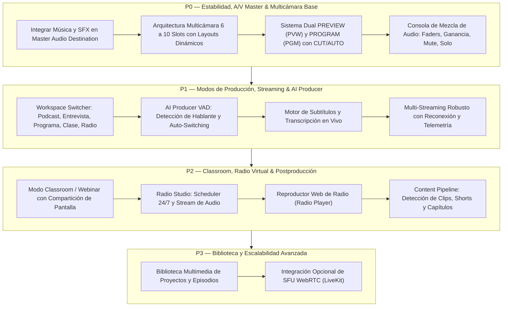

# 📋 AUDITORÍA TÉCNICA EXHAUSTIVA — PODCASTUDIO VIRTUAL PRODUCTION STUDIO
**Fecha de Auditoría:** 26 de Octubre, 2026  
**Versión Auditada:** v1.0.10 (Producción Oficial)  
**Autor:** Antigravity Architect & Real-Time Media Engineering Team  
**Objetivo:** Evolución integral de PodcaStudio hacia un Estudio Virtual Multipropósito Profesional (Podcasts, Entrevistas, Programas, Clases, Webinars, Cursos, Live Streaming, Producción Multicámara, Radio Virtual 24/7, Asistencia IA y Distribución Automatizada).

---

## A. ARQUITECTURA ACTUAL

### 1. Stack Tecnológico Base
* **Frontend UI**: React 18.2.0 + Vite 5.1.4 (SPA empaquetada y servida localmente / en la nube).
* **Entorno Desktop / Native Host**: Electron 29.1.0 con proceso principal Node.js (`electron/main.js`), puente seguro `contextBridge` (`electron/preload.js`), y lanzador de alto rendimiento compilado en C# (.NET Framework 4.0/4.8 `launcher.cs` -> `PodcastStudio.exe` con icono oficial HD de 285 KB).
* **Estilizado & Diseño**: Tailwind CSS 4.0.0 + CSS Modules para componentes y modales con temas oscuros de transmisión (`#0a0a0c`, `#111`, acentos ámbar/naranja broadcast).
* **Iconografía**: `lucide-react` (0.344.0).
* **Documentos & Prompter**: `mammoth` (1.13.0) para extracción y renderizado directo de archivos de Word `.docx` en el teleprompter.

### 2. Backend, Servidores y Conectividad
* **Servidor Local Híbrido (Electron Main)**:
  * Express 4.18.2 + HTTPS (`https.createServer` en puerto 3000 con certificados autofirmados vía `selfsigned`).
  * Servidor HTTP complementario (`http.createServer` en puerto 3001) para señalización WebSocket estándar sin bloqueos de certificados en navegadores móviles (iOS Safari / Android Chrome).
  * WebSocket Server (`ws` 8.16.0) para señalización directa WebRTC P2P en red local con clientes móviles `/camara`.
* **Capa Cloud / WAN**:
  * Despliegue en la nube en Vercel: `https://www.podcastudio.mx`.
  * Supabase Client (`@supabase/supabase-js` 2.118.0) utilizado exclusivamente para **Broadcast Channels** en memoria (señalización WebRTC para cámaras remotas e intercambio bidireccional de telemetría y órdenes con la consola iPad `StudioRemoteControl.jsx`). No se utiliza actualmente como base de datos persistente ni autenticación relacional.
* **Infraestructura WebRTC**:
  * STUN Servers: `stun.cloudflare.com:3478`, `stun.l.google.com:19302`, `stun1/stun2`.
  * TURN Servers: `turn:openrelay.metered.ca:80`, `turn:openrelay.metered.ca:443`, `turns:openrelay.metered.ca:443?transport=tcp`.

### 3. Motores de Medios en Tiempo Real (A/V Engine)
* **Master Canvas Compositor (`masterBroadcastEngine.js`)**:
  * Lienzo HTML5 Canvas off-screen a 1080p (1920x1080) corriendo a 30 FPS fijos sincronizado con `requestAnimationFrame`.
  * Composición gráfica por capas: Fondo virtual -> Croma Key (filtro y screen blend) -> Capa de cámaras según layout -> Logo oficial -> Cintillos/Lower Thirds animados.
  * Captura de stream de video mediante `canvas.captureStream(30)` con flag `contentHint = 'motion'`.
* **Motor de Mezcla de Audio (Web Audio API DSP)**:
  * AudioContext a 48,000 Hz estéreo con nodo de destino `createMediaStreamDestination()`.
  * Encadenamiento y suma de pistas de micrófonos locales, cámaras USB auxiliares y streams WebRTC de participantes remotos.
  * Procesador DSP de efectos vocales en tiempo real (`voiceEffectsProcessor.js`): Radio FM (filtro paso alto + EQ + compresor dinámico broadcast), Estadio/Auditorio (doble delay con damping), Eco de cabina, Marciano (Ring Modulator a 72 Hz), Teléfono (paso banda 400Hz-3.4kHz), Monstruo y Ardilla cómica.
* **Codificación y Grabación Local (FFmpeg Pipeline)**:
  * `MediaRecorder` en el hilo de render capturando el `masterStream` compuesto con códec `video/webm;codecs=h264,opus` (o `video/mp4;codecs=avc1`) a 10.0 Mbps y chunks emitidos cada 500 ms.
  * IPC hacia Electron (`record-chunk`) que escribe en el `stdin` de un binario nativo de FFmpeg (`ffmpeg-static`).
  * Parámetros FFmpeg: `-c:v libx264 -preset veryfast -crf 17 -maxrate 12M -bufsize 24M -pix_fmt yuv420p -r 30 -g 60 -keyint_min 30 -c:a aac -b:a 192k -ar 48000 -movflags +faststart` generando un contenedor MP4 sin trabas de reproducción.
* **Transmisión en Vivo Multi-RTMP (`start-streaming`)**:
  * Spawning de procesos FFmpeg independientes por cada destino activo (YouTube, Facebook Live RTMPS, TikTok, RTMP genérico).
  * Pipe directo de chunks desde el compositor hacia los encoders RTMP sin recompresión redundante en JavaScript.

---

## B. FUNCIONES EXISTENTES EN EL REPOSITORIO

1. **Estudio Monocámara / Multicámara Básico**:
   - Conexión de cámaras locales por `getUserMedia` (cámaras web integradas, webcams USB, capturadoras HDMI Cam Link/Elgato).
   - Detección de dispositivos UVC en Windows.
   - Conexión de cámaras de acción y streams IP vía URL (MJPEG / HLS / RTSP).
   - Sondeo en red local de dispositivos activos mediante lectura de tabla ARP de Windows y escaneo de puertos TCP (4747 DroidCam, 8080 IP Webcam, 8192 Action Cam, 8554 RTSP).
2. **Cámara Remota para Celulares (`RemoteCam.jsx`)**:
   - Interfaz web móvil responsive accesible por enlace o código QR.
   - Selector de cámara frontal y trasera (`facingMode: 'environment' / 'user'`).
   - Control de linterna/flash del celular si la cámara trasera lo soporta.
   - Motor de adaptación dinámica de tasa de bits y resolución (Quality Tiers: HD 720p 2.5 Mbps, 720p 2.0 Mbps, SD 540p 1.4 Mbps) evaluando RTT de la conexión.
   - Grabación local de respaldo en el almacenamiento del celular (`localBackupActive`).
3. **Mando Switcher a Distancia para iPad / Tablets (`StudioRemoteControl.jsx`)**:
   - Consola táctil web adaptada a pantallas de iPad y navegadores Safari/Chrome.
   - Botonera para alternar cámaras al aire (CAM 1 a CAM 4).
   - Activación de PiP y selección de layouts.
   - Botón de grabación remota (inicio y parada) con visualización del cronómetro del master.
   - Activación y cambio de presets de cintillos al aire.
4. **Composición Gráfica y Cintillos (Lower Thirds)**:
   - 9 estilos gráficos (Glass, Cyber, News, Minimal, Bold, Neon, Elegant, Vintage, Corporate).
   - Editor de cintillos en tiempo real con rotación automática temporizada (`useCintilloRotation.js`).
   - Generación de propuestas de cintillos automáticos según tema e invitados.
5. **Zoom Dinámico y Encuadre 1:1**:
   - Control de zoom interactivo en la pantalla Master mediante la rueda del ratón (scroll).
   - Recorrido / Paneo de la toma (drag con clic izquierdo) para encuadrar participantes estilo ventana de Windows.
   - Modal de calibración independiente (`CameraCalibratorModal.jsx`) para previsualizar, ajustar brillo, contraste, saturación, balance de blancos y LUTs cinematográficos por cámara.
6. **Música de Fondo y Efectos Sonoros (SFX)**:
   - Banco de 12 canciones organizadas por géneros con previsualización (`MusicBank.jsx`).
   - Sistema de Auto-Ducking que atenúa automáticamente el volumen de la música cuando detecta voz en el micrófono.
   - 28 efectos de sonido (risas, puertas, cristales, aplausos, ovaciones, ring tones, bocinas) servidos desde CDN de Mixkit.
7. **Grabación y Exportación Multi-Formato**:
   - Grabación directa en disco a 1080p MP4 dentro de `D:\PROGRAMAS IA\PODCASTUDIO\proyectos\[NombreProyecto]\`.
   - Generación automática de foto miniatura oficial en alta definición (`_Thumbnail.jpg`).
   - Modal de re-encuadre y exportación multi-formato (`MultiFormatExportModal.jsx`) para Facebook (16:9), YouTube (16:9), TikTok/Reels (9:16) e Instagram (1:1).
8. **Teleprompter Integrado**:
   - Subida y lectura de archivos de Microsoft Word `.docx`.
   - Control de velocidad, tamaño de fuente y scroll automático continuo en pantalla.

---

## C. FUNCIONES REALMENTE FUNCIONALES

| Función | Estado Real | Comportamiento Comprobado |
| :--- | :--- | :--- |
| **Grabación Master MP4 en Disco** | ✅ 100% Funcional | Escribe a 1080p 30fps sin trabas, cierra el moov atom con `+faststart` y guarda en la carpeta del proyecto. |
| **Generación de Miniaturas HD** | ✅ 100% Funcional | Extrae snapshot a 1080p del canvas master y genera JPG tanto en la grabación como en exportaciones. |
| **Zoom Dinámico y Paneo con Mouse** | ✅ 100% Funcional | Zoom continuo con scroll del ratón y arrastre fluido con clic izquierdo sin saltos abruptos. |
| **Cintillos y Gráficos al Aire** | ✅ 100% Funcional | Se superponen tanto en la UI de monitorización como en el video final grabado y transmitido. |
| **Efectos de Modulación de Voz DSP** | ✅ 100% Funcional | Web Audio DSP procesa en tiempo real filtros de radio, estadio, marciano, etc., e ingresan a la mezcla. |
| **Mando a Distancia iPad (Switcher)** | ✅ 100% Funcional | Conecta bidireccionalmente vía Supabase Broadcast Channel y comanda cambios de cámara y REC desde iPad. |
| **Cámara Remota WebRTC para Celulares** | ✅ 100% Funcional | Transmite audio/video WebRTC de celular a PC con emparejamiento por QR y negociación SDP. |
| **Escaneo ARP / Puertos de Cámaras WiFi**| ✅ 100% Funcional | Ejecuta `arp -a` y prueba sockets TCP en puertos 4747, 8080, 8192 de la LAN en Electron. |
| **Exportación a Redes (FFmpeg Nativo)** | ✅ 100% Funcional | Recorta y escala en Electron a 9:16 (1080x1920) y 1:1 (1080x1080) usando FFmpeg local. |
| **Lanzador C# Nativo (`PodcastStudio.exe`)**| ✅ 100% Funcional | Arranca Electron directamente manteniendo el icono incrustado de 285 KB intacto. |

---

## D. FUNCIONES INCOMPLETAS, SIMULADAS O DESCONECTADAS

1. **Inyección de Música y SFX en la Grabación Master (CRÍTICO)**:
   - `MusicBank.jsx`, `useBackgroundMusic.js` y `useSoundEffect.js` crean elementos `new Audio()` en el DOM del navegador.
   - Aunque el operador escucha la música por sus altavoces o auriculares, **el audio de la música y los efectos NO está conectado al nodo `audioDestination` de `masterBroadcastEngine.js`**.
   - **Consecuencia**: El archivo MP4 final grabado y la transmisión RTMP NO contienen la música de fondo ni los SFX, o solo ingresan de forma deficiente si se filtran físicamente por el micrófono ambiental.
2. **Arquitectura Multicámara Limitada a 4 Ranuras Rígidas**:
   - Aunque `cameraSlots.js` tiene una constante `MAX_CAMERA_SLOTS = 20`, en `src/App.jsx` y `masterBroadcastEngine.js` los layouts están cableados de forma rígida únicamente para modos `'1'`, `'pip'`, `'2'`, `'3'`, `'4'`.
   - No existen algoritmos para componer 5, 6, 8 o 10 cámaras en pantalla, ni modo Two-Shot dinámico, ni Gallery View flexible, ni Speaker View automático.
3. **Ausencia de Separación Real entre PREVIEW (PVW) y PROGRAM (PGM)**:
   - El sistema opera únicamente en modo Program directo (todo clic envía la cámara inmediatamente al aire).
   - No existe una barra de transición (T-Bar), ni botón de `CUT` / `AUTO`, ni monitor dual donde se prepare una toma con zoom/cintillo en PVW antes de lanzarla al Master (PGM).
4. **Capa "SFUStreamTransport" Simulada (Placeholder)**:
   - En `src/utils/streamTransport.js` líneas 329–346, la clase `SFUStreamTransport` tiene únicamente logs en consola: `// Mock / Pasarela para cliente SFU externo (LiveKit Room / Mediasoup Device)`. No hay conexión a un SFU real.
5. **Código Muerto en `exportVideo.js`**:
   - Línea 50 busca `window.electronAPI.transcodeVideo`. Sin embargo, `preload.js` expone `window.api`, no `window.electronAPI`. Esa rama nunca se ejecuta y recurre innecesariamente a WASM en la web.
6. **Módulo de Postproducción / IA Inexistente**:
   - El botón de IA en cintillos utiliza una función heurística de plantillas estáticas (`generateBroadcastProposals`), sin integración real con ningún LLM, transcriptor Whisper, ni extractor de momentos clave.
7. **Modos de Producción Inexistentes**:
   - No hay selector de espacio de trabajo para Podcast, Entrevista, Clase, Webinar, Live Stream, Radio o Multicámara. La UI es un bloque monolítico único.
8. **Módulo de Radio Virtual Inexistente**:
   - No existe scheduler 24/7, ni generador de stream Icecast/HLS/WebRTC continuo, ni reproductor web de radio.

---

## E. PROBLEMAS ENCONTRADOS Y RIESGOS TÉCNICOS

### 1. Monolito en `src/App.jsx` (3,380 líneas)
- `App.jsx` concentra el estado de la UI, timers de teleprompter, WebRTC listeners, IPC handlers, zoom con mouse, atajos de teclado, subida de documentos mammoth, selección de efectos vocales y renderizado de modales.
- **Riesgo**: Fragilidad extrema. Modificar un componente de audio o cámara corre el riesgo de desatar re-renders masivos que degradan el framerate del canvas master.

### 2. Dispersión y Sincronización A/V en Grabación Canvas
- `canvas.captureStream(30)` genera una señal de video basada en ticks de temporizador del navegador.
- Si la CPU se satura o la ventana pierde foco, Chromium puede ralentizar los ticks de `requestAnimationFrame`, desfasando el audio (que corre en el reloj de hardware del `AudioContext`) respecto al video.

### 3. Falta de Mezclador de Audio de Hardware (Virtual Audio Mixer)
- No hay controles de Ganancia individual por canal (fader en dB), ni botón de `SOLO`, ni medidor estéreo en el Master general con aviso de pico/clipping (distorsión digital sobre 0 dBFS).

### 4. Cuello de Botella de Ancho de Banda P2P en Múltiples Invitados Remotos
- Al usar WebRTC malla P2P (cada celular transmite directamente a la PC), a partir de 4 conexiones entrantes con resoluciones de 720p, el ancho de banda de subida/bajada y el uso de decodificadores de video en la máquina del usuario aumentan exponencialmente.

---

## F. DEPENDENCIAS EXISTENTES Y CAPACIDADES

| Dependencia | Versión | Rol en el Proyecto | Evaluación |
| :--- | :--- | :--- | :--- |
| `react` / `react-dom` | 18.2.0 | Núcleo de componentes UI | Estable |
| `electron` | 29.1.0 | Host de escritorio de alto rendimiento | Sólido y maduro |
| `ffmpeg-static` | 5.2.0 | Binario nativo FFmpeg empaquetado | Clave absoluta para grabación y streaming |
| `fluent-ffmpeg` | 2.1.2 | Wrapper para FFmpeg en Node.js | Instalado; en Electron se usa `spawn` directo por mayor control de streams |
| `@supabase/supabase-js` | 2.118.0 | Señalización en tiempo real vía WebSockets | Excelente para eventos y canales broadcast |
| `express` / `ws` | 4.18.2 / 8.16.0 | Servidor local y sockets LAN | Funcional para red interna |
| `selfsigned` | 5.5.0 | Generador de certificados HTTPS locales | Útil en LAN |
| `mammoth` | 1.13.0 | Lector de Word (.docx) para teleprompter | Ligero y eficiente |
| `qrcode` | 1.5.3 | Generación de códigos QR en canvas/DOM | Rápido y sin dependencias externas |
| `lucide-react` | 0.344.0 | Iconografía vectorial | Completo y ligero |

---

## G. QUÉ PODEMOS REUTILIZAR

1. **Tubería de Grabación FFmpeg Nativa (`electron/main.js`)**: El mecanismo de pipear chunks desde Electron a FFmpeg stdin con `-preset veryfast -crf 17 -g 60 -movflags +faststart` es sumamente sólido y produce MP4s de máxima compatibilidad.
2. **Motor de Composición en Canvas (`masterBroadcastEngine.js`)**: El renderizador de capas a 1080p 30fps es eficiente y ya soporta recorte dinámico de zoom y centrado de tomas.
3. **Capa Web Audio DSP (`voiceEffectsProcessor.js`)**: Los grafos de audio con filtros Biquad, delay, compresión broadcast y modulación en anillo son 100% reutilizables y limpios.
4. **Infraestructura de Señalización Supabase**: Los canales de broadcast para control remoto táctil y conexión de cámaras remotas funcionan con latencia sub-segundo sin costo de servidores dedicados.
5. **Componentes Gráficos y Overlays**: El sistema de cintillos (`CintilloOverlay.jsx`, presets y estilos) es profesional y está listo para integrarse en producciones de cualquier índole.
6. **Lanzador Nativo C# (`launcher.cs` / `compile-exe.ps1`)**: Sistema de compilación y empaquetado rápido que genera el EXE respetando el icono original sin requerir re-empaquetados pesados de instalador.

---

## H. QUÉ DEBEMOS CONSTRUIR

1. **Selector de Modo de Producción (Virtual Production Studio Workspaces)**:
   - Configuración inicial que adapte la interfaz y herramientas según el tipo de producción:
     1. *Podcast* (Cámaras enfrentadas, auto-ducking agresivo, rotación de cintillos de redes).
     2. *Entrevista* (Layouts split 50/50, two-shot, cintillos de cargo e invitado).
     3. *Programa de TV / Talk Show* (Multicámara completa, gráficos al aire, banco de efectos SFX, teleprompter).
     4. *Clase Virtual / Curso* (Modo Classroom: profesor destacado, presentación de diapositivas/PDF, pantalla compartida, chat y lista de alumnos).
     5. *Webinar* (Presentador principal, preguntas y respuestas Q&A, moderador, compartir pantalla).
     6. *Live Streaming* (Chat en vivo integrado, monitor de tasa de bits, multistreaming a YouTube/Facebook/Twitch).
     7. *Radio Virtual* (Cabina de radio, scheduler de programación horaria, streaming Icecast/HLS continuo, reproductor web).
     8. *Producción Multicámara* (Consola dual PREVIEW / PROGRAM, conmutación T-Bar, tally lights, 6 a 10+ cámaras).
2. **Sistema Profesional Multicámara Dual (PREVIEW / PROGRAM)**:
   - Monitor de PREVIEW (PVW) independiente del monitor de PROGRAM (PGM).
   - Botonera broadcast con acciones de corte directo (`CUT`), transición suave disolvencia (`AUTO` con duración regulable) y T-Bar táctil/ratón.
   - Soporte nativo para 6, 8 y 10 cámaras simultáneas con layouts de cuadrícula dinámica (1, 2, 3, 4, 6, 8, 10, PiP, Two-Shot, Wide-Shot, Gallery).
3. **Mezclador de Audio de Grado Profesional (Audio Console)**:
   - Integración real de la música de fondo y los efectos SFX en la tubería del `masterBroadcastEngine`.
   - Canal de mezcla individual por fuente: Fader de volumen, Ganancia de entrada, botón `MUTE`, botón `SOLO`, medidor estéreo VU de alta resolución.
   - Master Output Fader con limitador para evitar distorsión o clipping.
4. **Capa AI Producer (Modular y Configurable)**:
   - Detección activa de voz (Voice Activity Detection - VAD) en tiempo real mediante análisis de volumen/energía para sugerir cambios automáticos de cámara (*Auto-Switching* inteligente al que esté hablando).
   - Módulo transcriptor y generador de subtítulos en vivo (preparado para Web Speech API nativa sin costo y pasarela para Whisper / OpenAI / Gemini).
   - Generador automático de metadatos de postproducción: títulos sugeridos, descripción, marcas de tiempo (capítulos) y propuesta de clips virales cortos.
5. **Módulo Classroom & Webinar**:
   - Espacio con vista de profesor, pizarra/compartición de pantalla de alta resolución y cuadrícula de participantes/alumnos con petición de palabra (levantar la mano).
6. **Módulo Radio Studio 24/7**:
   - Scheduler de parrilla de programación horaria (bloques de música, cortinillas, podcasts grabados, anuncios).
   - Generador de stream de audio continuo (HLS Audio / stream HTTP compatible con reproductores de radio online).
   - Componente web `RadioPlayer.jsx` embebible para audiencia.
7. **Biblioteca Centralizada de Medios y Proyectos**:
   - Panel de exploración interno de grabaciones realizadas, cortes exportados, audios y pistas musicales con metadatos y búsqueda rápida.

---

## I. ORDEN RECOMENDADO DE IMPLEMENTACIÓN (FASES P0, P1, P2, P3)

---

## J. PLAN DETALLADO POR PRIORIDADES

### PRIORIDAD P0: NÚCLEO BROADCAST, AUDIO REAL Y MULTICÁMARA (CRÍTICO)
1. **P0.1 — Audio Engine Fix**: Conectar directamente el audio de la música de fondo y los efectos SFX al nodo `audioDestination` de `masterBroadcastEngine.js` mediante `createMediaElementSource` o buffers de Web Audio, garantizando que el MP4 final grabado y la transmisión contengan la música y los efectos con balance perfecto y auto-ducking.
2. **P0.2 — Expansión Multicámara a 6, 8 y 10 Ranuras**:
   - Actualizar los compositores de `masterBroadcastEngine.js` y `App.jsx` para admitir layouts dinámicos: 1 (Full), 2 (Split horizontal y vertical), 3 (1 grande + 2 laterales), 4 (Cuadrícula 2x2), 6 (Cuadrícula 3x2 y 1 principal + 5 mosaico), 8 (Cuadrícula 4x2), Gallery View y Two-Shot automático.
3. **P0.3 — Consola Dual PREVIEW / PROGRAM**:
   - Implementar la arquitectura estándar de control de televisión: monitor izquierdo de PREVIEW (para calibrar, encuadrar y verificar antes del aire) y monitor derecho de PROGRAM (Master en vivo).
   - Botón `CUT` (corte instantáneo sin cuadros negros) y botón `AUTO` (transición suave con fundido disolvente configurable entre 200ms y 1000ms).
4. **P0.4 — Consola de Audio y Medición Profesional**:
   - Panel de control de audio con fader independiente para cada canal (CAM 1 a CAM N, Música, SFX, Master), control de Ganancia (-24dB a +12dB), botón `MUTE`, botón `SOLO` y vúmetro estéreo con zona verde, amarilla y roja (+0dBFS warning).

### PRIORIDAD P1: ESPACIOS DE TRABAJO, IA PRODUCTORA Y STREAMING (IMPORTANTE)
1. **P1.1 — Sistema de Modos de Producción**:
   - Modal o selector de cabecera para cambiar el entorno de trabajo:
     * *Podcast*
     * *Entrevista*
     * *Programa en Vivo*
     * *Clase Virtual*
     * *Webinar*
     * *Live Stream*
     * *Radio*
     * *Producción Multicámara*
   - Ajuste automático de plantillas de cintillos, número de slots recomendados y disposición de paneles.
2. **P1.2 — AI Producer: Detección de Hablante y Auto-Switching**:
   - Analizador VAD (Voice Activity Detection) sobre las fuentes de audio conectadas.
   - Modo de realización asistida por IA: cuando el invitado o conductor toma la palabra durante más de 1.2 segundos, la IA recomienda o conmuta automáticamente la cámara a primer plano (Close-up o Speaker View).
3. **P1.3 — Transcripción y Subtítulos en Tiempo Real**:
   - Generación de subtítulos quemados en pantalla opcionales usando Web Speech API local del navegador (sin costo) con arquitectura extensible a modelos externos.
4. **P1.4 — Transmisión Multi-Destino con Monitor de Salud**:
   - Panel de telemetría de streaming (tasa de bits real, cuadros descartados por la red, estado de la conexión RTMP y reconexión automática en caso de caída).

### PRIORIDAD P2: CLASES, RADIO VIRTUAL Y POSTPRODUCCIÓN (EXPANSIÓN)
1. **P2.1 — Modo Classroom & Webinar**:
   - Vista de presentación con diapositivas/PDF y captura de pantalla compartida de alta nitidez (`getDisplayMedia`).
   - Panel de moderación y preguntas.
2. **P2.2 — Radio Studio & Scheduler 24/7**:
   - Parrilla de programación por bloques horarios.
   - Emisión de flujo de audio continuo (HLS Audio / Icecast compatible) procesado por el motor de audio en segundo plano.
   - Componente `RadioPlayer.jsx` web independiente.
3. **P2.3 — Content Pipeline de Postproducción**:
   - Generador automático de clips cortos verticales (9:16) y propuesta de marcas de tiempo basada en la duración y los picos de conversación.

### PRIORIDAD P3: BIBLIOTECA CENTRALIZADA Y ESCALABILIDAD
1. **P3.1 — Biblioteca de Proyectos y Medios**:
   - Gestor visual de grabaciones, miniaturas y pistas con opción de renombrar, previsualizar y catalogar episodios.
2. **P3.2 — Preparación para SFU Cloud (LiveKit)**:
   - Conexión opcional a SFU para producciones masivas de más de 15 cámaras remotas concurrentes.

---

## K. PRIMERA IMPLEMENTACIÓN RECOMENDADA (P0 INMEDIATO)

Para comenzar la transformación sin alterar la estabilidad de lo que ya funciona, el primer paso riguroso es:
1. **P0.1 & P0.4 — Corregir la integración de Música/SFX en `masterBroadcastEngine.js` y agregar el Mezclador de Audio Multicanal** (para que todo el sonido que el usuario configure se grabe y transmita de verdad al 100%).
2. **P0.2 — Elevar el motor de composición de 4 ranuras a arquitectura elástica de 6, 8 y 10 cámaras** con soporte de layouts dinámicos (Two-Shot, Gallery, 6-Grid).
3. **P0.3 — Introducir la barra de control PREVIEW / PROGRAM con CUT y AUTO** para realización profesional.
